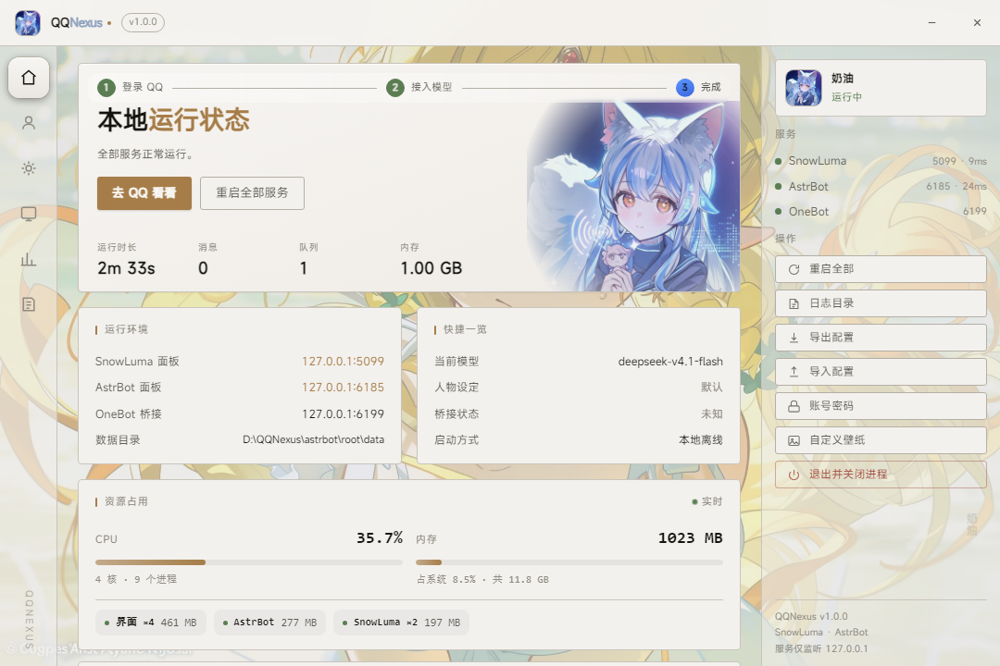
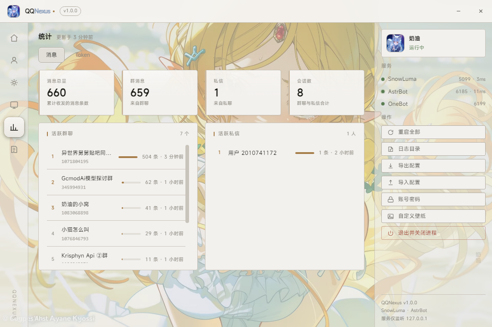
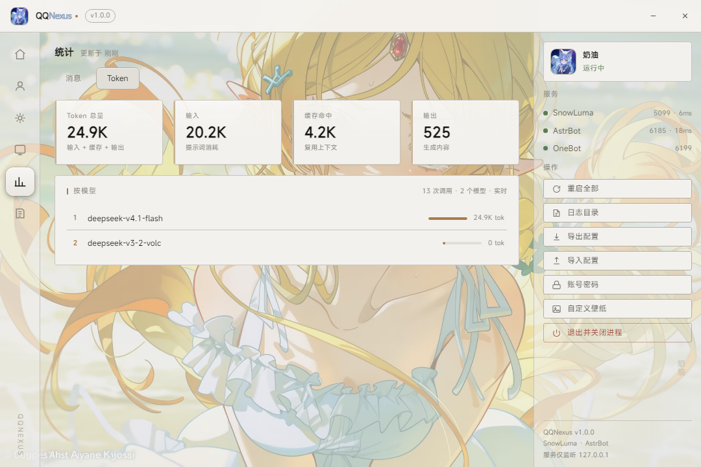

# QQNexus

SnowLuma + AstrBot 一体化本地启动器。一个窗口管住 QQ 机器人整套运行环境：
登录 QQ、接入模型、看统计、盯资源占用，全部在 127.0.0.1 上跑，不外发数据。



## 它解决什么问题

自己搭 QQ 机器人要装三个东西：SnowLuma（接 QQ）、AstrBot（管模型和人设）、
一个把两者连起来的 OneBot 桥。三者端口、令牌、启动顺序都要手工对齐，
错一个就连不上。

QQNexus 把这些包进一个桌面应用：

- **一键启动**：SnowLuma 5099 + AstrBot 6185 + OneBot 6199 自动拉起并互相连通
- **桥接自动配置**：反向 WS 端口和令牌由客户端统一生成，两端永远一致
- **模型一处配置**：填一次 API Base / Key，自动写进 AstrBot 的 provider_sources
- **真实统计**：消息量、活跃群（带群名）、Token 消耗、CPU/内存实时曲线
- **只监听回环**：所有服务绑定 127.0.0.1，不暴露到局域网

## 界面

| 总览 | 统计 | Token |
|---|---|---|
|  |  |  |

## 架构

```
Electron 主进程 (ui/main.js)
├─ 拉起 SnowLuma        node.exe index.mjs      127.0.0.1:5099
├─ 拉起 AstrBot         python main.py          127.0.0.1:6185
│                        └─ OneBot 反向 WS       127.0.0.1:6199
├─ 桥接配置同步         snowluma/config/onebot*.json  ← 同一份令牌
├─ 凭据管理             credential.json（客户端为准）
└─ 资源采样             PowerShell 常驻采样进程，2s 一次
```

数据流：QQ 客户端 → SnowLuma → (OneBot WS) → AstrBot → 模型 API。

## 快速开始

### 前置

- Windows 10/11 x64
- 已安装并登录 QQ 客户端（SnowLuma 通过 Hook 接管，不需要扫码）

### 安装

1. 下载 Release 里的完整包，解压到任意目录（路径不要有空格）
2. 双击 `QQNexus.bat`
3. 首次启动会自动：
   - 创建 Python 环境并安装 AstrBot 依赖（需要联网，约 5 分钟）
   - 生成 `credential.json`（面板密码、OneBot 令牌）
   - 展开 AstrBot 面板静态资源
4. 在「模型」页填 API Base、Key、模型名，保存
5. 打开 http://127.0.0.1:5099 登录 QQ

### 从源码构建

```bash
git clone https://github.com/fsrmwu/QQNexus.git
cd QQNexus/ui
npm install
npm start
```

第三方运行时（AstrBot / SnowLuma 源码与发行包）不在仓库内，
用 `scripts/fetch_vendor.py` 按 `vendor-lock.json` 拉取：

```bash
python scripts/fetch_vendor.py
```

## 目录说明

```
ui/           Electron 前端（单文件 index.html + main.js 主进程）
scripts/      运行时脚本：配置生成、凭据同步、统计、名字回填
plugins/      AstrBot 插件：qqnexus_stats（消息统计）
winbuild/     Windows 打包工程
```

## 关键事实

| 项 | 值 |
|---|---|
| SnowLuma WebUI | 127.0.0.1:5099（`X-Frame-Options: DENY`，不能内嵌） |
| SnowLuma OneBot | 127.0.0.1:6199 反向 WS 服务端 |
| AstrBot 面板 | 127.0.0.1:6185 |
| AstrBot provider key | 在 `provider_sources[].key` 数组里，不在 `provider[]` |
| 人设存储 | `data_v4.db` 的 `personas` 表 |
| Token 统计 | `data_v4.db` 的 `provider_stats` 表 |

## 已知限制

1. **QQ 登录凭据不持久** — 由腾讯签发，会话失效需重新登录
2. **SnowLuma 面板不能内嵌** — 桌面版用独立窗口打开
3. **AstrBot 首启慢** — 约 40-60 秒（装插件 + 迁移数据库），期间 OneBot 显示未连通属正常
4. **私信昵称可能为空** — QQ 侧未返回昵称时显示号码

## 许可

本项目代码：MIT。
第三方组件：AstrBot（AGPL-3.0）、SnowLuma（见其仓库），各自遵循原许可。
